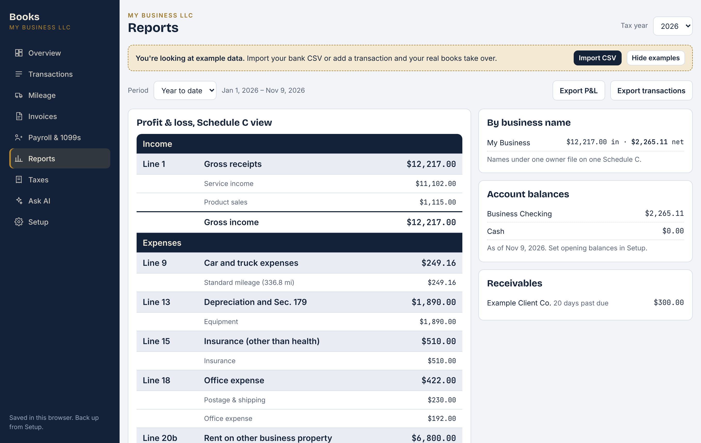
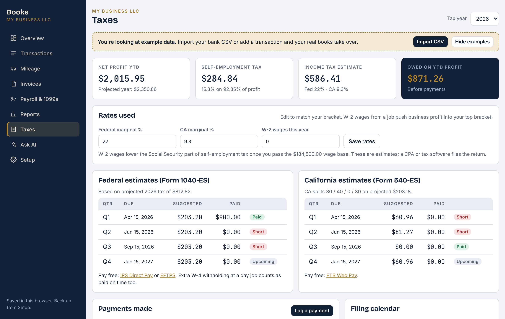

<h1 align="center">Lazy Accounting Core</h1>

<p align="center"><b>The open Schedule C engine behind <a href="https://lazyaccounting.com">Lazy Accounting</a></b>: industry charts of accounts, a vendor-rule transaction categorizer, IRS mileage rates, self-employment tax and the quarterly estimated-tax calendar.<br>Plain JavaScript, no dependencies, Node 18+ or any browser.</p>

<p align="center">
  <a href="https://lazyaccounting.com">Live app</a> ·
  <a href="https://lazyaccounting.com/pricing">Pricing</a> ·
  <a href="#-quick-start">Quick start</a> ·
  <a href="#-api">API</a>
</p>

---

## 🎬 The full product

<p align="center">
  <a href="https://lazyaccounting.com"></a>
</p>

<p align="center"><sub>Watch the 2:26 walkthrough on <a href="https://lazyaccounting.com">lazyaccounting.com</a>: bank import, AI sorting into Schedule C, receipts, invoices, bills, reconciling and payroll.</sub></p>

Lazy Accounting is bookkeeping, payroll and tax tracking for freelancers, solo owners and small service businesses, built by **Nova R&D Labs LLC**. It runs on Cloudflare Workers and D1. This repository holds the part that's safe and useful to share: the tax-category logic. Accounts, bank sync, payroll withholding, billing and the app itself live in the private product.

<table>
  <tr>
    <td></td>
    <td></td>
  </tr>
</table>

## 📦 What's in here

- **12 industry charts of accounts**, each mapped to Schedule C lines with vendor rules: notary and loan signing · beauty and salon · auto repair · food and catering · freelance and consulting · cleaning and home services · retail and online store · construction and trades · delivery, rideshare and trucking · real estate · health and wellness · photo, video and creative.
- **Rule-based categorizer**: keyword rules like `HOME DEPOT => Job materials`, plus deposit-only rules (`UBER +=> Rideshare income`) so a refund or purchase never lands in income.
- **AI fallback prompt**: whatever the rules can't sort becomes one prompt you can send to any chat model (Claude, OpenAI, Gemini).
- **IRS standard mileage rates** by date: 70¢ for 2025, 72.5¢ for Jan–Jun 2026, 76¢ from July 1, 2026.
- **Self-employment tax** (Schedule SE) with the 2026 Social Security wage base ($184,500) and W-2 wages from a day job.
- **Quarterly estimated tax calendar**: federal 25% each quarter, California 30 / 40 / 0 / 30, weekend dates moved to Monday.
- **Treasury Tipped Occupation Codes** (TTOC, W-2 box 14b) for the 2025 no-tax-on-tips rules.

## 🚀 Quick start

```bash
git clone https://github.com/oxayavongsa/lazy-accounting-core.git
cd lazy-accounting-core
npm test
```

```javascript
import { categorizeTransaction, getMileageRate, selfEmploymentTax } from "./src/index.js";

categorizeTransaction({ description: "HOME DEPOT #0642 SACRAMENTO CA", amount: -148.92, industry: "trades" });
// => { category: "Job materials", type: "expense", scheduleCLine: "4",
//      lineLabel: "Cost of goods sold", confidence: "rule_match", rule: "HOME DEPOT => Job materials" }

getMileageRate("2026-08-01");   // => 0.76
selfEmploymentTax(50000).total; // => 7064.78
```

## 🧩 API

| Function | Returns |
|---|---|
| `buildCategories(industries)` | Chart of accounts: `[{ name, type, line, lineLabel }]` |
| `rulesFor(industries)` | Vendor rules for those industries plus the defaults |
| `categorizeTransaction({ description, amount, industry, rules? })` | `{ category, type, scheduleCLine, lineLabel, confidence, rule }` |
| `buildCategorizePrompt(transactions, industries)` | A prompt for any AI model; answer is a JSON array of category names |
| `getMileageRate(date)` | IRS rate in dollars per mile on that date |
| `mileageDeduction(trips)` | `{ miles, deduction }`, each trip priced at its own date's rate |
| `selfEmploymentTax(net, { w2Wages?, wageBase? })` | `{ taxableBase, socialSecurity, medicare, total, deductibleHalf }` |
| `estimatedTaxSchedule(year, { state })` | `{ federal: [...], state: [...] }` with due dates and shares |
| `ttocName(code)` | Occupation name for a TTOC code |

Industry ids: `notary`, `beauty`, `auto`, `food`, `freelance`, `cleaning`, `retail`, `trades`, `transport`, `realestate`, `wellness`, `creative`.

## 📚 Sources

IRS Schedule C (Form 1040) line numbers · IRS standard mileage rates (Notice 2026-10 and the July 1, 2026 increase) · Schedule SE and the 2026 Social Security wage base · FTB Form 540-ES installment percentages · Treasury list of occupations that customarily and regularly received tips.

## ⚠️ Disclaimer

This is bookkeeping logic, not tax, legal or financial advice. Check important numbers with a qualified professional.

## 📄 License

Code: [MIT](LICENSE). The Lazy Accounting name, the Ledger mascot, screenshots and the full application are © Nova R&D Labs LLC.

<p align="center"><sub>Built by <b>Nova R&amp;D Labs LLC</b> · <a href="https://lazyaccounting.com">lazyaccounting.com</a> · support@lazyaccounting.com</sub></p>
